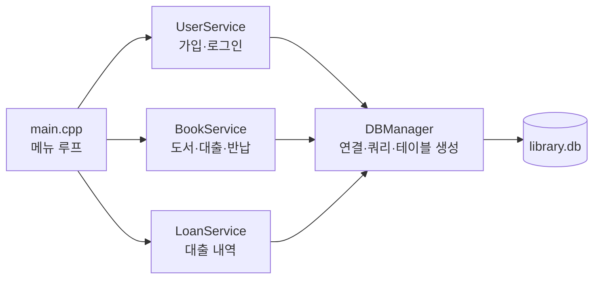
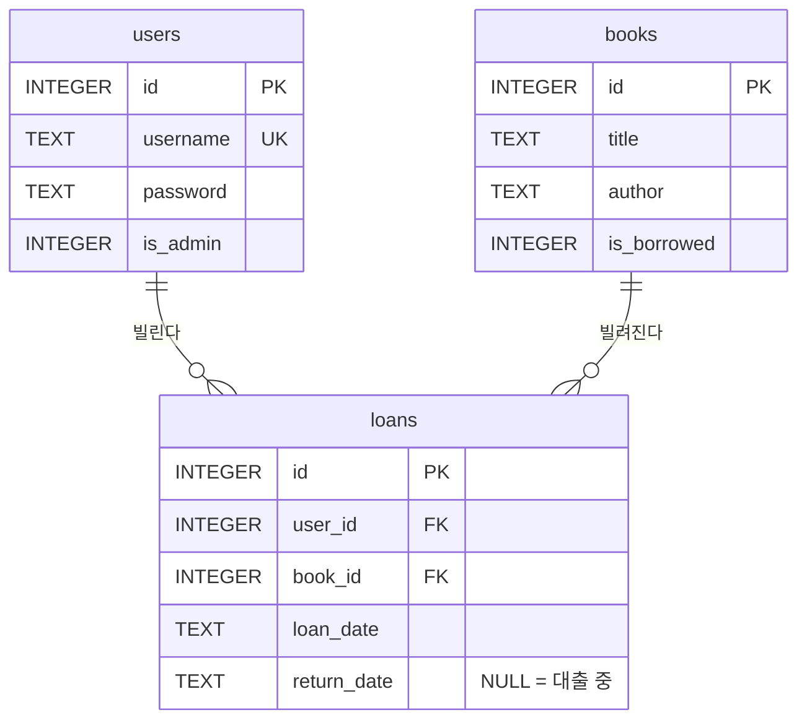

# library-management-system

> **C++ · SQLite3 도서관 관리 프로그램 (콘솔)**

C++ 코드에서 SQLite3를 직접 연결해 회원, 도서, 대출을 관리하는 콘솔 프로그램입니다.
SQL을 DB 도구에서만 쳐 보는 게 아니라, 프로그램 안에서 열고, 쿼리를 준비하고, 결과를 한 줄씩 읽어 오는 과정을 직접 해 보고 싶어서 만들었습니다.

## 사용 기술

| 구분 | 기술 |
|---|---|
| 언어 | **C++20** |
| 데이터베이스 | **SQLite3** (C API, 소스 포함) · SQL |
| 빌드 | CMake |
| 개발 도구 | CLion, DataGrip, Git |
| 실행 환경 | 콘솔(CLI) |

## 만든 것

| 대상 | 기능 |
|---|---|
| 공통 | 회원가입(관리자/일반 선택), 로그인 |
| 일반 사용자 | 도서 목록, 대출, 내 대출 내역, 반납 |
| 관리자 | 도서 등록, 사용자 목록, 전체 대출 현황 |



---

## 만들면서

### 1. 계획을 먼저 세웠습니다 (2025-05)

처음에는 코드보다 README에 구현 순서를 7단계로 적는 것부터 했습니다. SQLite 연결 → 회원가입·로그인 → 권한 분기 → 사용자 기능 → 관리자 기능 → 예외 처리 → 심화 기능 순서였습니다.

첫 버전([`v1-login`](https://github.com/EseungQ/library-management-system/tree/v1-login))은 `main.cpp` 한 파일에 회원가입, 로그인, 로그아웃까지만 들어 있습니다. 계획은 7단계였는데 실제로는 2단계에서 멈춰 있었습니다. 큰 그림을 먼저 그려 두니 어디까지 왔는지는 분명히 보였습니다.

### 2. 테이블을 프로그램이 만들지 않았습니다

1차본 코드에는 `CREATE TABLE`이 한 줄도 없습니다. 테이블은 DataGrip에서 따로 만든 DB 파일(`cmake-build-debug/test.db`)에 있었고, 프로그램은 그게 이미 있다고 믿고 동작했습니다. 그래서 내 PC에서는 잘 돌아도, 새로 받은 사람이 실행하면 회원가입부터 실패합니다.

완성본에서는 `DBManager::initSchema()`가 시작할 때 `CREATE TABLE IF NOT EXISTS`로 테이블 3개를 만들게 바꿨습니다. 프로그램이 돌아가는 데 필요한 준비는 프로그램이 스스로 해야 한다는 걸 이때 알았습니다.

### 3. 한 파일에서 클래스로 나눴습니다 (2025-06)

1차본은 DB 핸들과 로그인 사용자가 전역 변수였고, 모든 함수가 `main.cpp`에 있었습니다. 로그인만 있을 때는 괜찮았지만, 도서와 대출 기능을 붙이려고 하니 한 파일에서 감당하기 어려웠습니다.

그래서 DB 연결과 쿼리 실행은 `DBManager`에, 기능은 `UserService`, `BookService`, `LoanService`에 나눠 담았습니다. 서비스들은 `DBManager`를 참조로 받아 같은 연결을 같이 씁니다. 나누고 나니 `main.cpp`는 메뉴와 입력만 남았고, 기능을 하나 더 붙일 때 어디를 고치면 되는지가 분명해졌습니다.

`windows.h`로 콘솔 인코딩을 바꾸던 부분도 빼서, 표준 C++만으로 빌드되게 했습니다.

### 4. 구조를 바꾸다가 지키던 것을 놓쳤습니다

나중에 다시 보면서 가장 크게 느낀 부분입니다. 1차본 회원가입·로그인은 `sqlite3_bind_text`로 값을 따로 넣었습니다. 그런데 클래스로 옮기면서 SQL을 문자열로 이어 붙이는 방식으로 바뀌었습니다.

그 결과 지금 버전은 아이디에 `admin'--`를 넣으면 비밀번호 없이 로그인됩니다(2026-11 직접 확인). 기능을 늘리고 구조를 정리하는 데 집중하다 보니, 원래 지키던 것이 빠져도 알아챌 방법이 없었습니다. 테스트가 하나라도 있었다면 바로 드러났을 문제입니다.

---

## 다시 만든다면

| 남은 문제 | 고칠 방법 |
|---|---|
| SQL을 문자열로 이어 붙여 SQL injection에 뚫림 | 모든 쿼리를 `sqlite3_bind_*`로 바꾸기 |
| 비밀번호를 평문으로 저장 | 솔트를 붙인 해시로 저장 |
| 가입할 때 누구나 관리자를 고를 수 있음 | 첫 관리자만 따로 만들고, 권한은 관리자가 부여 |
| 대출·반납이 SQL 두 번으로 나뉘어, 중간에 실패하면 도서 상태와 대출 기록이 어긋날 수 있음 | `BEGIN` ~ `COMMIT` 트랜잭션으로 묶기 |
| 외래 키 제약이 실제로는 꺼져 있음 | 연결 후 `PRAGMA foreign_keys = ON;` |
| 로그아웃하면 프로그램이 끝나고, 도서 ID에 글자를 넣으면 메뉴가 끝없이 반복됨 | 로그인 루프를 바깥으로 빼고 `cin.fail()` 처리 |

처음 계획에 있었지만 하지 못한 것도 남아 있습니다. 도서 검색, 도서 삭제, 연체일 계산, 페이지네이션, 로그 파일입니다.

---

## 실행하기

```bash
git clone https://github.com/EseungQ/library-management-system.git
cd library-management-system
cmake -B build && cmake --build build
./build/Library_Project        # Windows: build\Library_Project.exe
```

CLion에서는 폴더를 열고 `Library_Project`를 실행하면 됩니다. SQLite3 소스(3.49.2)가 `third_party/sqlite/`에 들어 있어 따로 설치할 필요가 없습니다. 처음 실행하면 `library.db`가 생기니, `[2] Register`로 관리자 계정을 만들고 도서를 등록하면 됩니다.

## 폴더 구조

```
src/                 프로그램 소스
  main.cpp             메뉴 루프 (로그인 → 일반/관리자 메뉴)
  DBManager.*          SQLite 연결, SQL 실행, 테이블 생성
  UserService.*        회원가입, 로그인, 사용자 목록
  BookService.*        도서 목록·등록·대출·반납
  LoanService.*        내 대출, 전체 대출 현황
third_party/sqlite/  SQLite 3.49.2 (public domain)
CMakeLists.txt       빌드 설정
```

## DB 구조


